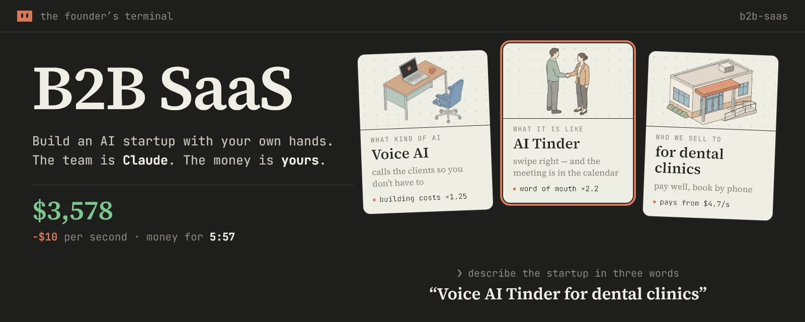
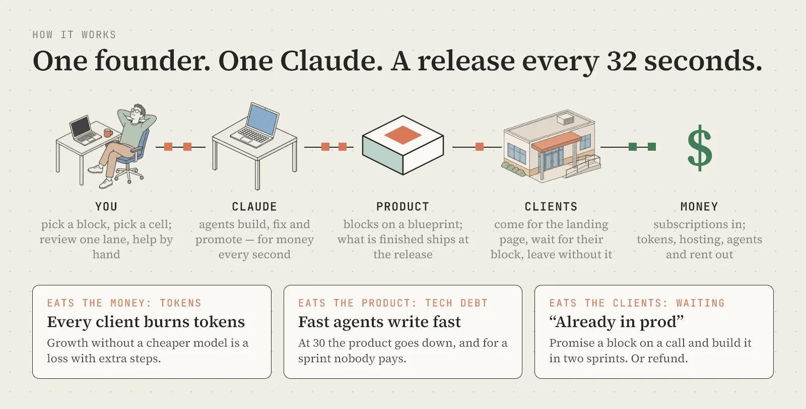
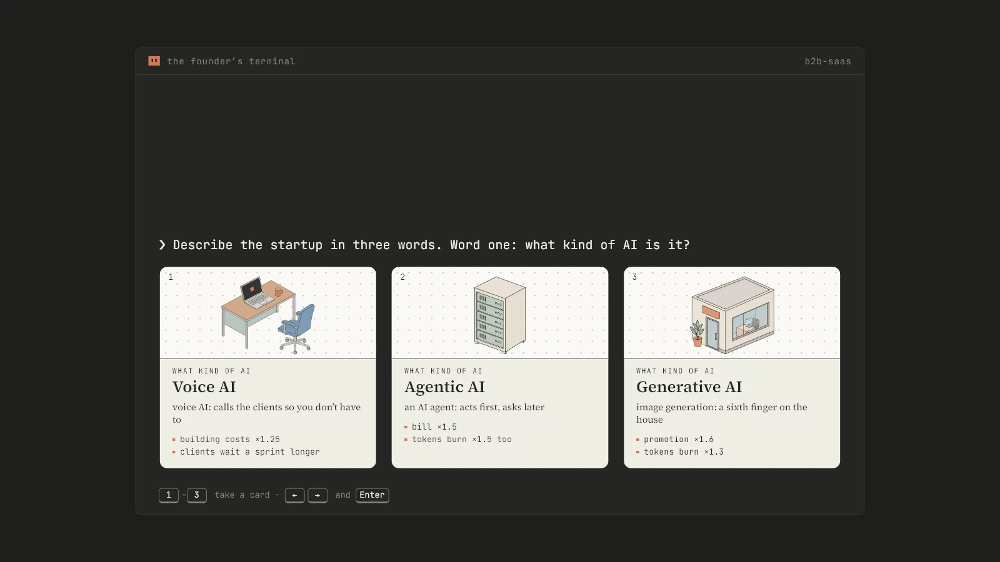
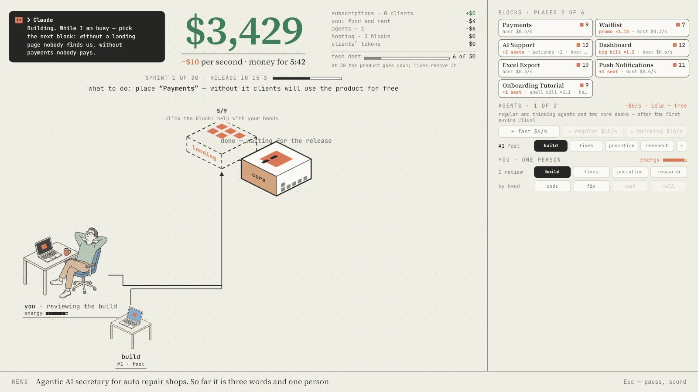
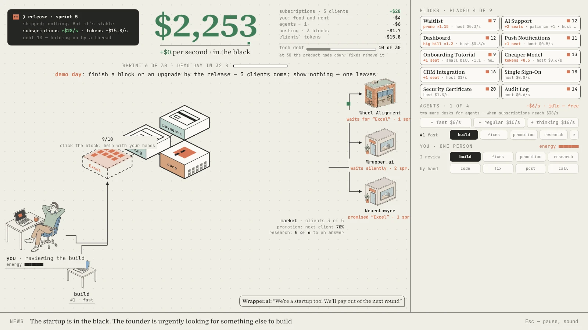
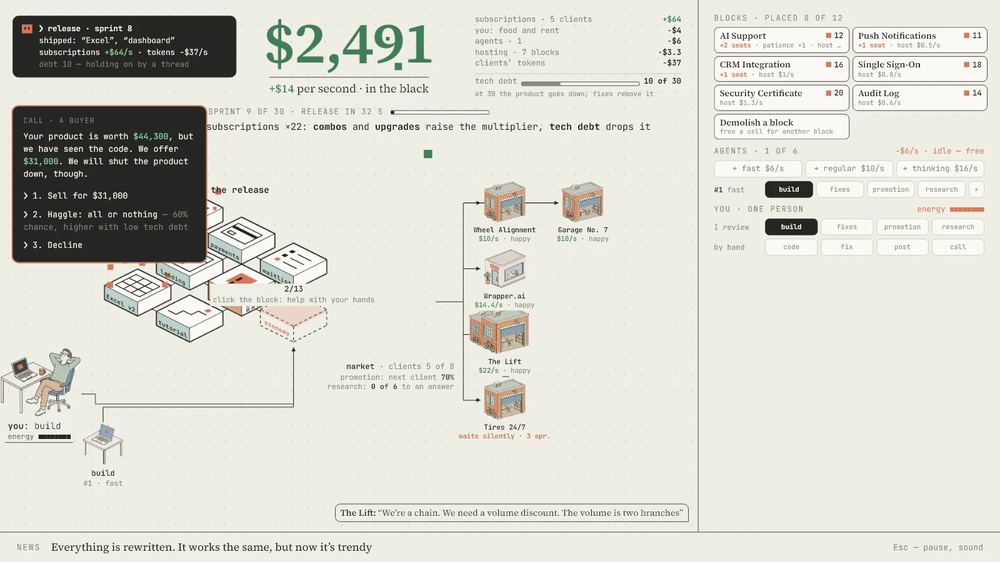
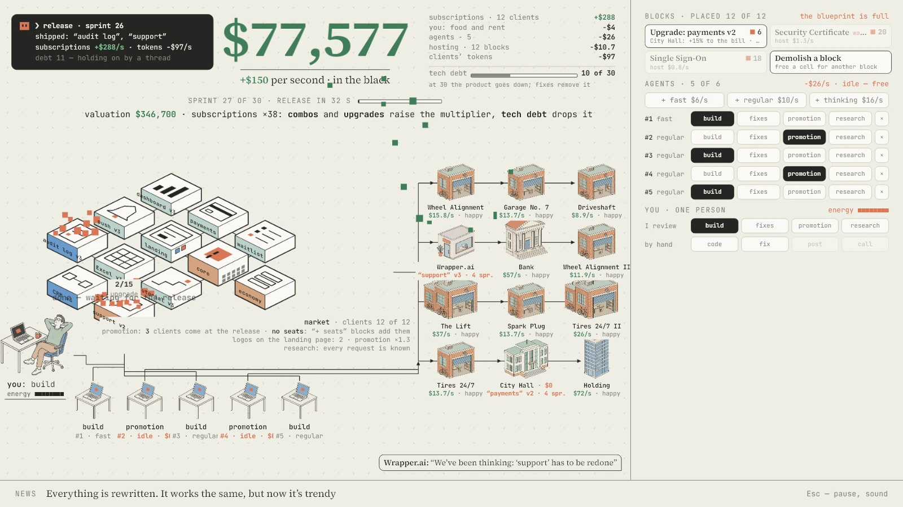
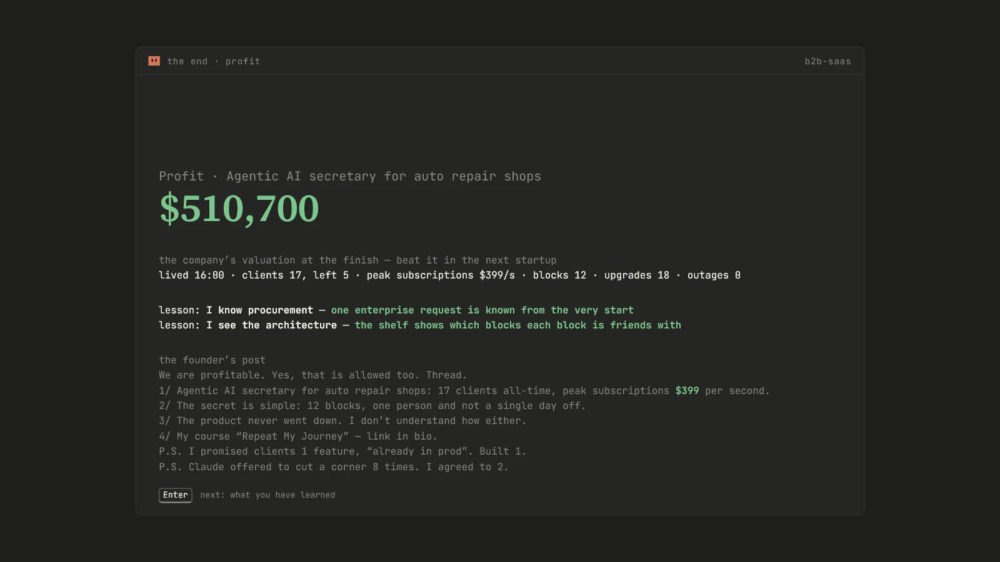
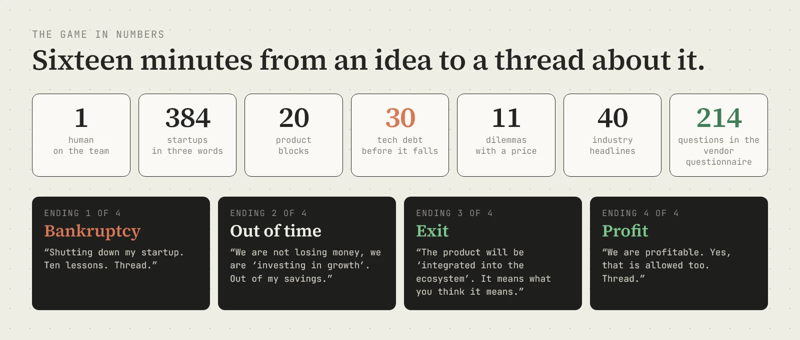

<p align="center">
  <a href="https://troyan-dy.github.io/b2b-saas/"></a>
</p>

<p align="center"><b>English</b> · <a href="README.ru.md">Русский</a></p>

<p align="center">
  <a href="https://troyan-dy.github.io/b2b-saas/"></a>
  
  
</p>

# B2B SaaS

A tycoon about building an AI startup alone. The team is Claude. The money is yours, and it runs out in about six minutes.

**Play: https://troyan-dy.github.io/b2b-saas/**

## The pitch

1. Describe the startup in three words. “Voice AI Tinder for dental clinics” is a valid answer.
2. Put a Claude wrapper on the blueprint. Add a landing page. Remember about payments later than you should.
3. Turn a profit within 30 sprints. Or at least shut down gracefully and write a thread about it.

<p align="center"></p>

## What it looks like

The idea is dealt in a terminal. The startup itself is a paper blueprint: the product in the middle, the founder and the agents on the left, the clients on the right, every dollar per second in plain sight.

<table>
  <tr>
    <td width="50%"><br><sub><b>1 · The idea.</b> Three decks, three cards from each: what kind of AI, what it is like, who pays for it.</sub></td>
    <td width="50%"><br><sub><b>2 · The kitchen.</b> One founder, one fast agent, an empty blueprint. Claude builds; you click to help.</sub></td>
  </tr>
  <tr>
    <td><br><sub><b>3 · First clients.</b> A release every 32 seconds. Clients come, wait for the block they need and do not always say which one.</sub></td>
    <td><br><sub><b>4 · A call.</b> Somebody always wants an answer: a client, a blogger, the press, a buyer, the bank. Every answer has a price.</sub></td>
  </tr>
  <tr>
    <td><br><sub><b>5 · A city of clients.</b> The blueprint is full, the agents cost more than rent, and procurement has sent a questionnaire.</sub></td>
    <td><br><sub><b>6 · The ending.</b> One big number and a founder’s post. Then the same founder starts over, a little wiser.</sub></td>
  </tr>
</table>

<p align="center"></p>

## What is inside

- **Three kinds of agents.** Fast: lots of code, lots of debt. Regular: writes like a human, so-so. Thinking: slow, expensive, no debt.
- **Five kinds of clients.** Small business, chains, startups like yours, corporations, and one government client that will sign. Someday.
- **Calls.** “Do you have an API? We won’t do anything with it, but it has to exist.” Answer honestly and lose a quarter of the bill, or say “already in prod” and build it in two sprints.
- **Dilemmas.** Claude offers to delete the tests: they are blocking the release.
- **Demo days, trends, competitors and a model provider** that raises prices “due to increased value”.
- **A founder who stays.** Traits and lessons carry over to the next startup. Claude does not remember the last one. You will.

## Languages

English and Russian. The game takes the language of the browser; the last line of the menu switches it. `?lang=en` or `?lang=ru` in the address forces one.

## Build it yourself

```
npm install
npm run dev      # the game at http://localhost:5174/
npm run build    # the build in dist/
npm test         # formulas, saves, determinism
```

The pictures of this page are made from the game itself: `npm run build:gym && node tools/readme.mjs`.

Made with Phaser 4, TypeScript, Vite and ZzFX; the music is CC0 from OpenGameArt. Licences of everything third-party are in [public/LICENSES.txt](public/LICENSES.txt).

B2B SaaS is set in the world of [Yes-Driven Development](https://troyan-dy.github.io/yes-driven-development/) — the clicker where the human made exactly one decision. Here there are more of them, and that turns out to be the problem.

Author: [github.com/troyan-dy](https://github.com/troyan-dy).

The names Claude, Anthropic, Tinder, Uber, Excel and SAP are used as parody; the game is not affiliated with or endorsed by these companies.
