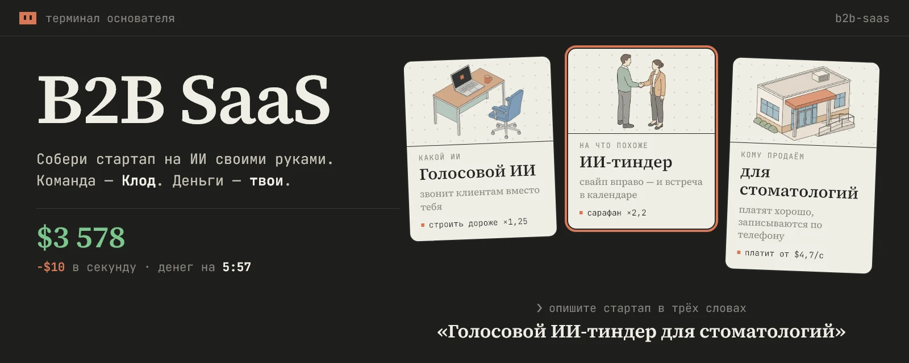
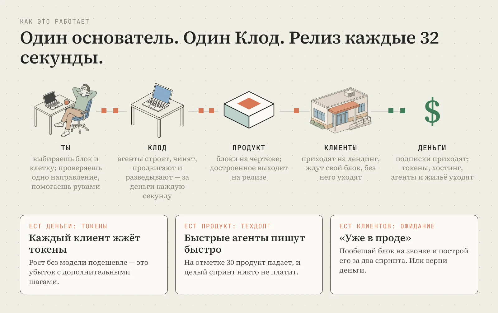
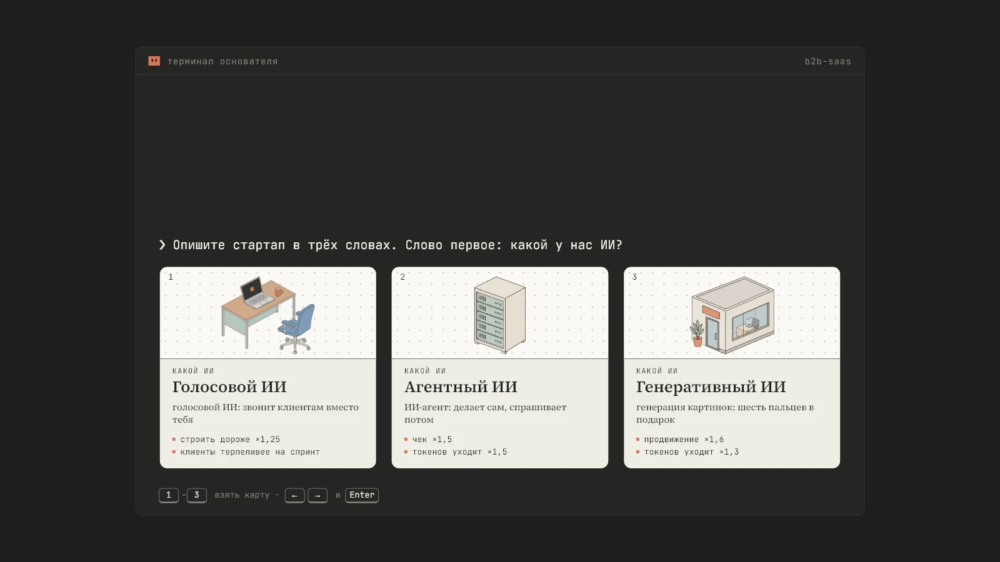
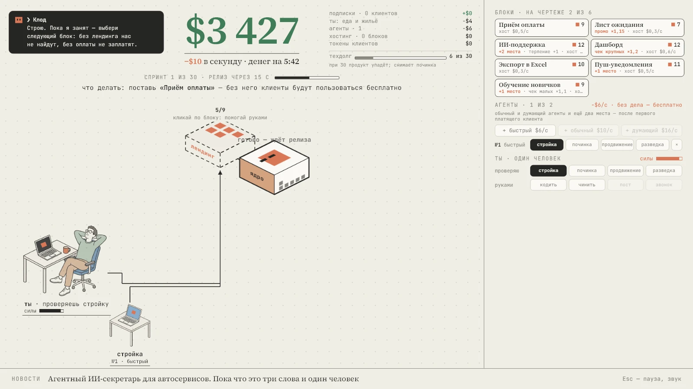
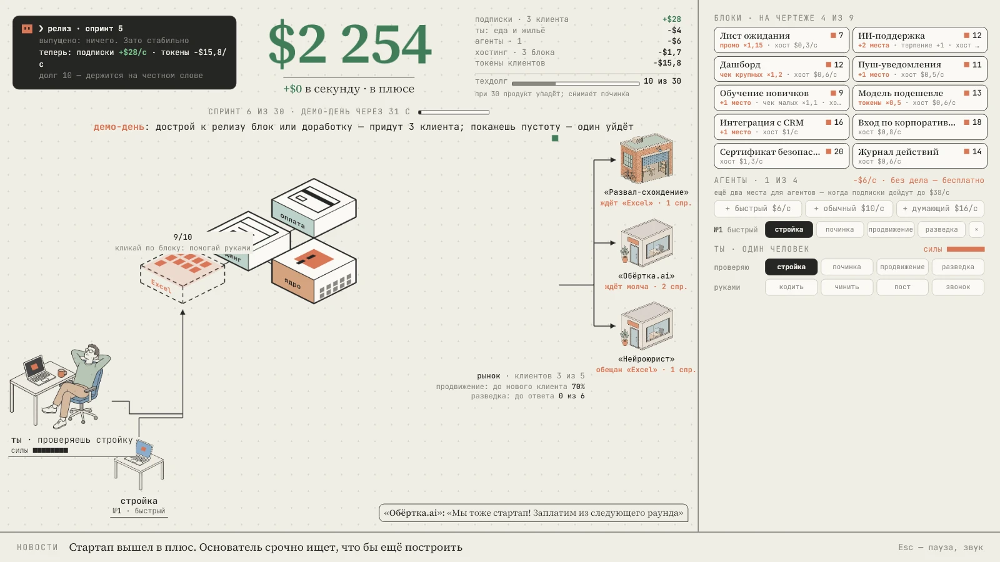
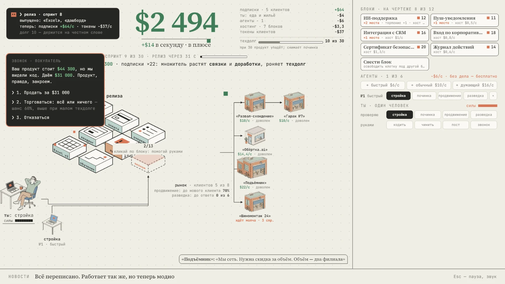
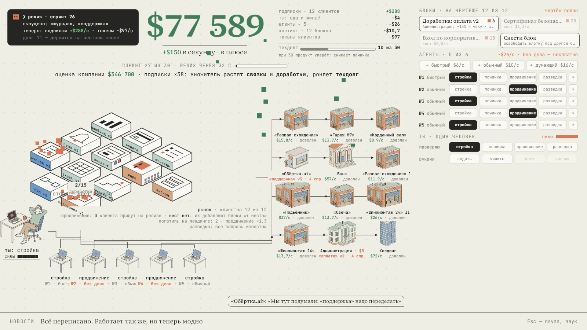
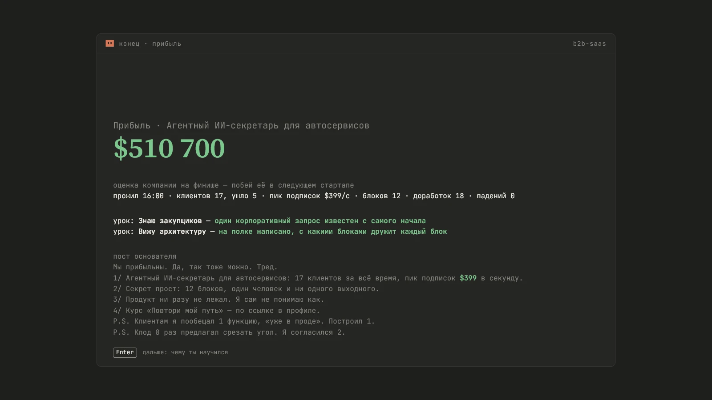
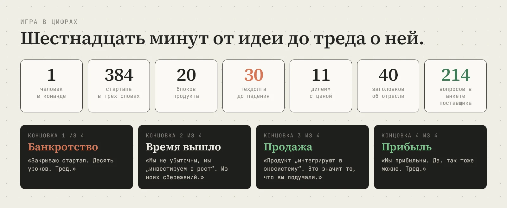

<p align="center">
  <a href="https://troyan-dy.github.io/b2b-saas/"></a>
</p>

<p align="center"><a href="README.md">English</a> · <b>Русский</b></p>

<p align="center">
  <a href="https://troyan-dy.github.io/b2b-saas/"></a>
  
  
</p>

# B2B SaaS

Тайкун о том, как в одиночку собрать стартап на ИИ. Команда — Клод. Деньги — твои, и хватит их минут на шесть.

**Играть: https://troyan-dy.github.io/b2b-saas/**

## Питч

1. Опиши стартап в трёх словах. «Голосовой ИИ-тиндер для стоматологий» — допустимый ответ.
2. Поставь на чертёж обёртку над Клодом. Добавь лендинг. Про приём оплаты вспомни позже, чем следовало.
3. Выйди в плюс за 30 спринтов. Или хотя бы красиво закройся и напиши об этом тред.

<p align="center"></p>

## Как это выглядит

Идея раздаётся в терминале. Сам стартап — бумажный чертёж: продукт посередине, основатель и агенты слева, клиенты справа, каждый доллар в секунду на виду.

<table>
  <tr>
    <td width="50%"><br><sub><b>1 · Идея.</b> Три колоды, по три карты из каждой: какой ИИ, на что похоже, кто за это платит.</sub></td>
    <td width="50%"><br><sub><b>2 · Кухня.</b> Один основатель, один быстрый агент, пустой чертёж. Клод строит; ты помогаешь кликами.</sub></td>
  </tr>
  <tr>
    <td><br><sub><b>3 · Первые клиенты.</b> Релиз каждые 32 секунды. Клиенты приходят, ждут нужный блок и не всегда говорят какой.</sub></td>
    <td><br><sub><b>4 · Звонок.</b> Кому-то всегда нужен ответ: клиенту, блогеру, прессе, покупателю, банку. У каждого ответа есть цена.</sub></td>
  </tr>
  <tr>
    <td><br><sub><b>5 · Город клиентов.</b> Чертёж полон, агенты стоят дороже жилья, а отдел закупок прислал анкету.</sub></td>
    <td><br><sub><b>6 · Концовка.</b> Одно большое число и пост основателя. Потом тот же основатель начинает заново, чуть умнее.</sub></td>
  </tr>
</table>

<p align="center"></p>

## Что внутри

- **Три вида агентов.** Быстрый: много кода, много долга. Обычный: пишет как человек, средне. Думающий: медленно, дорого, зато без долга.
- **Пять видов клиентов.** Малый бизнес, сети, такие же стартапы, корпорации и один госзаказчик, который подпишет. Когда-нибудь.
- **Звонки.** «У вас есть API? Мы ничего не будем с ним делать, но он должен быть». Ответь честно и потеряй четверть чека — или скажи «уже в проде» и построй за два спринта.
- **Дилеммы.** Клод предлагает удалить тесты: они мешают релизу.
- **Демо-дни, тренды, конкуренты и поставщик модели**, который поднимает цены «в связи с возросшей ценностью».
- **Основатель остаётся.** Черты и уроки переходят в следующий стартап. Клод прошлый не помнит. Помнить будешь ты.

## Языки

Русский и английский. Игра берёт язык браузера; переключает его последняя строка меню. `?lang=ru` или `?lang=en` в адресе задаёт язык явно.

## Собрать самому

```
npm install
npm run dev      # игра на http://localhost:5174/
npm run build    # сборка в dist/
npm test         # формулы, сохранения, детерминизм
```

Картинки этой страницы сняты с самой игры: `npm run build:gym && node tools/readme.mjs`.

Сделано на Phaser 4, TypeScript, Vite и ZzFX; музыка — CC0 с OpenGameArt. Лицензии всего стороннего — в [public/LICENSES.txt](public/LICENSES.txt).

Действие B2B SaaS происходит в мире [Yes-Driven Development](https://troyan-dy.github.io/yes-driven-development/) — кликера, где человек принимал ровно одно решение. Здесь решений больше, и в этом, как выясняется, проблема.

Автор: [github.com/troyan-dy](https://github.com/troyan-dy).

Названия Claude, Anthropic, Tinder, Uber, Excel и 1С упомянуты в порядке пародии; игра с этими компаниями не связана и ими не одобрена.
