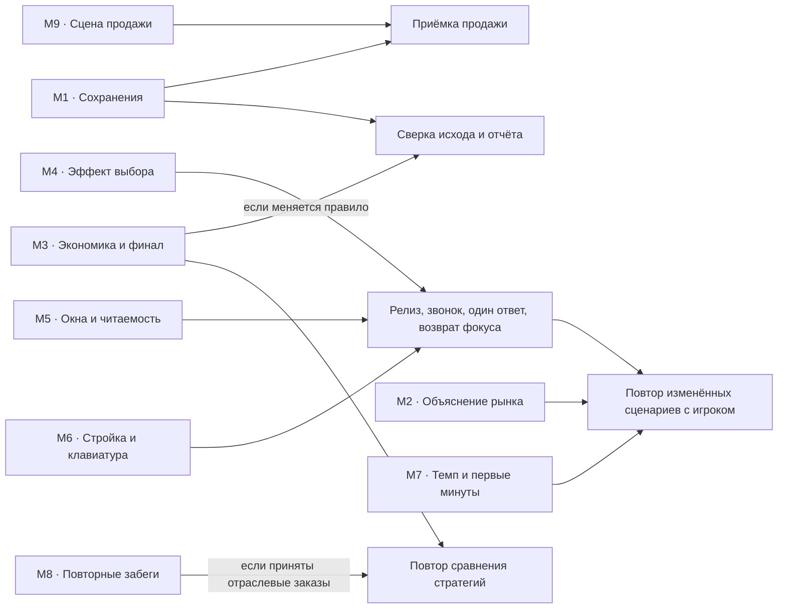

# Дерево исправлений после аудита 0.4.2

[Карта бэклога в GitHub](https://github.com/troyan-dy/b2b-saas/issues/21)

**База** — аудит 0.4.2 от 17 ноября 2026, коммит `7ba3d9f`. В дереве 29 открытых рабочих задач: 11 новых, четыре дополненные аудитом и 14 ранее открытых. Карта [#21](https://github.com/troyan-dy/b2b-saas/issues/21) объединяет их и не входит в число 29.

Первый результат для игрока — безопасно прервать забег и вернуться к нему. М1 можно принять и передать игроку сразу после проверки. Сравнения баланса и прототип отраслей идут своим ходом.

### Как загрузить три исполнителя

| Направление | Стартуют одновременно | Куда переходит освободившийся исполнитель |
| --- | --- | --- |
| Игровая логика | М1. Сохранение партии и результата | М4. Фактическая польза выбора. Затем подключение М9, когда утверждена сцена продажи |
| Рынок и интерфейс | М2. Причины отказа клиента | М5. Экраны релиза. Затем М6. Прогноз и управление стройкой |
| Геймдизайн | М3. Парные прогоны экономики и финала | М7. Живые прохождения. Затем М8. Сравнение повторных забегов и двух отраслей |

Это порядок занятия трёх рабочих мест. Снимки базовой версии, запись звука, беседу с игроком и эскиз продажи можно брать раньше на освободившееся место. Параллельные правки ведутся в отдельных рабочих копиях; ведущий объединяет и проверяет их по одной.

### Где действительно требуется чужой результат

Стрелки ведут к совместным проверкам. Например, устранение потери сохранения можно закончить до решения о правиле победы. Сквозная проверка ввода нужна после сборки М4–М6: при открытом звонке наступает релиз, одно нажатие подтверждает один выбор, затем игрок размещает здание с клавиатуры.

### Девять майлстоунов

#### М1. Сохранения и достоверный итог

Задачи — [#39](https://github.com/troyan-dy/b2b-saas/issues/39), [#40](https://github.com/troyan-dy/b2b-saas/issues/40), [#41](https://github.com/troyan-dy/b2b-saas/issues/41).

Одной доработкой жизненного цикла компании закрывать [#39](https://github.com/troyan-dy/b2b-saas/issues/39) и [#40](https://github.com/troyan-dy/b2b-saas/issues/40). Старый забег доступен до подтверждения нового, завершённый забег и ожидающая награда переживают обновление. Для [#41](https://github.com/troyan-dy/b2b-saas/issues/41) из этого же состояния строятся итог и резюме. Исправление неверных цифр можно выпустить при действующем правиле победы.

**Проверка.** Обновить вкладку в питче, на финале и до/после получения черты. Компания, запись и награда сохраняются ровно один раз. При оборвавшейся прибыли, нулевой выручке и продаже итог совпадает с историей и суммой сделки. Проверить старое сохранение.

#### М2. Почему клиент покупает или ждёт

Задачи — [#31](https://github.com/troyan-dy/b2b-saas/issues/31), [#43](https://github.com/troyan-dy/b2b-saas/issues/43), [#49](https://github.com/troyan-dy/b2b-saas/issues/49).

В одном изменении окна клиентов показать, что мешает продаже. Для [#31](https://github.com/troyan-dy/b2b-saas/issues/31) и [#43](https://github.com/troyan-dy/b2b-saas/issues/43) это могут быть места именных договоров, общая мощность или обязательное соседство CRM и бота. Для [#49](https://github.com/troyan-dy/b2b-saas/issues/49) та же область показывает, какое требование, тарифное ожидание или спрос изменились на релизе.

**Проверка.** В трёх состояниях игрок различает заполненные места, перегрузку мощности и недостающую связь. Две одинаковые компании с разным соседством объясняют разницу в продажах. После перемены рынка видны сегмент, направление и конкретное изменившееся условие в RU и EN.

#### М3. Какие решения определяют победу

Задачи — [#10](https://github.com/troyan-dy/b2b-saas/issues/10), [#24](https://github.com/troyan-dy/b2b-saas/issues/24), [#38](https://github.com/troyan-dy/b2b-saas/issues/38), [#42](https://github.com/troyan-dy/b2b-saas/issues/42).

Геймдизайнер запускает парные забеги на одинаковых стартах. Для [#10](https://github.com/troyan-dy/b2b-saas/issues/10) и [#24](https://github.com/troyan-dy/b2b-saas/issues/24) одна серия сравнивает активный и пассивный конец партии, сегментные стратегии, разные идеи и ускорение через API. Теми же сохранениями проверяются две отдельные границы — кассовый разрыв с залогом квартиры и сбой поставщика на финальном ходу.

**Проверка.** По каждой гипотезе есть своё сравнение и вывод. Для [#38](https://github.com/troyan-dy/b2b-saas/issues/38) видны цена спасения и возможность восстановиться на разных стадиях. Для [#42](https://github.com/troyan-dy/b2b-saas/issues/42) сравниваются устойчивая прибыль со сбоем, устойчивый убыток и выход в плюс последним действием. Новое правило победы или изменение сложности принимается после сравнения и живой игры.

#### М4. Честный результат выбора карты и дилеммы

Задачи — [#30](https://github.com/troyan-dy/b2b-saas/issues/30), [#44](https://github.com/troyan-dy/b2b-saas/issues/44).

Сверить обещание перед выбором с фактическим результатом в том же состоянии. На карточке учитывать запас сил, текущий долг и нижний предел стоимости токенов. Для журналиста показать риск за указанный период и фактическое количество ушедших клиентов. Выгода от объединения — один набор парных проверок; расчёты карты и дилеммы остаются разными.

**Проверка.** Для карт совпадают полная, частичная и нулевая польза, видны штрафы. Для дилемм сопоставлены осторожный и рискованный ответы, число прерываний и вероятность на оставшихся релизах. Сообщения верны при 0, 1 и 2 договорах.

#### М5. Что видно в момент релиза

Задачи — [#27](https://github.com/troyan-dy/b2b-saas/issues/27), [#36](https://github.com/troyan-dy/b2b-saas/issues/36), [#46](https://github.com/troyan-dy/b2b-saas/issues/46).

Один владелец интерфейса сначала устраняет подтверждённое перекрытие цели звонком или сообщением о карте. Если этот порядок показа решает и потерю контекста в [#36](https://github.com/troyan-dy/b2b-saas/issues/36), одно изменение может закрыть обе задачи. Для [#46](https://github.com/troyan-dy/b2b-saas/issues/46) отдельно проверяются постоянные подписи причин строительства и условий найма.

**Проверка.** На 1280×720, 1366×768 и 1920×1080 пройти релиз, выбор карты, звонок, дилемму и предложение покупателя. Видны цель и варианты ответов, работают мышь и клавиатура. На двух меньших экранах игрок при 100% масштабе читает причину стройки и разницу между агентами. Существенную перестройку потока решений согласовать после проверки.

#### М6. Стройка и управление командой

Задачи — [#34](https://github.com/troyan-dy/b2b-saas/issues/34), [#37](https://github.com/troyan-dy/b2b-saas/issues/37), [#45](https://github.com/troyan-dy/b2b-saas/issues/45), [#48](https://github.com/troyan-dy/b2b-saas/issues/48).

Первым дать прогноз ближайшего релиза ([#45](https://github.com/troyan-dy/b2b-saas/issues/45)). Затем пройти одним маршрутом размещение, переназначение и перестройку ([#34](https://github.com/troyan-dy/b2b-saas/issues/34) и [#48](https://github.com/troyan-dy/b2b-saas/issues/48)). Для [#37](https://github.com/troyan-dy/b2b-saas/issues/37) измерить число и цену переключений при команде из 6 и 12 агентов. Групповое назначение оправдано, если повторные команды мешают игре.

**Проверка.** Прогноз сходится с выпуском при неизменных условиях и пересчитывается после помощи, ускорения одной задачи и переназначения. С клавиатуры можно разместить блок и назначить агента. Снос на длинной полке можно найти, отменить и завершить с понятными последствиями. Удобство большой команды проверено в игре.

#### М7. Первые минуты и темп спринтов

Задачи — [#22](https://github.com/troyan-dy/b2b-saas/issues/22), [#23](https://github.com/troyan-dy/b2b-saas/issues/23), [#26](https://github.com/troyan-dy/b2b-saas/issues/26), [#29](https://github.com/troyan-dy/b2b-saas/issues/29), [#32](https://github.com/troyan-dy/b2b-saas/issues/32).

Один набор живых прохождений вместо пяти изолированных тестов. Сначала записать опыт нового игрока до первой оплаты, затем подготовленный и неподготовленный демо-день, ручные действия и смену темпа в середине и конце. На тех же эпизодах прослушать тихое начало и насыщенный конец. Длительность сессии определяется сценарием.

**Проверка.** По каждому вопросу есть отдельный результат: понял ли новичок первую оплату и было ли интересно; успел ли подготовиться к демо-дню и чем отличается бот; дали ли доступные ручные действия преимущество при том же запасе сил; где возникало ожидание; какие звуки утомляли. Изменённые эпизоды повторены на общей сборке.

#### М8. Причина начать другую компанию

Задачи — [#28](https://github.com/troyan-dy/b2b-saas/issues/28), [#33](https://github.com/troyan-dy/b2b-saas/issues/33), [#35](https://github.com/troyan-dy/b2b-saas/issues/35), [#47](https://github.com/troyan-dy/b2b-saas/issues/47).

В серии повторных забегов проверить частоту и цену просьб клиента, пользу реально заработанных черт и разнообразие текущей коллекции. Затем испытать один небольшой прототип: одинаковый старт, две отрасли, разные первые заказы. Этот прототип одновременно даёт материал для [#28](https://github.com/troyan-dy/b2b-saas/issues/28) и [#35](https://github.com/troyan-dy/b2b-saas/issues/35), а сравнение силы черт идёт на прежних правилах.

**Проверка.** Есть наблюдение по частоте, срокам и возможности отказаться от просьбы, сравнение свежего и накопленного профиля, а также решение о потребности в открытиях. По [#47](https://github.com/troyan-dy/b2b-saas/issues/47) игрок объясняет, почему для каждой отрасли построил конкретную функцию. Масштабирование контента и изменения метапрогрессии требуют отдельного выбора.

#### М9. Сцена продажи компании

Задачи — [#25](https://github.com/troyan-dy/b2b-saas/issues/25).

Постановку складывания чертежа в коробку можно согласовать и подготовить параллельно. Подключать переход к экрану итогов после проверки сохранения результата продажи в М1.

**Проверка.** Продажа показывает согласованную сцену и приводит к правильному итоговому посту. После перезагрузки сумма сделки и награда сохранены по одному разу. Приёмка включает просмотр кадра или короткого видео.

### Владельцы общих файлов

- Жизненный цикл компании — `src/main.ts`, `src/game/flow.ts`, `src/content/endings.ts`, `src/systems/run/save.ts`, `src/systems/meta/meta.ts`. Один владелец ведёт переход к итогам через М1, М3 и М9.
- Рынок и правила — `src/systems/company/`, `src/systems/run/`, `src/data/balance/`. Эксперименты воспроизводят одни и те же старты через `src/gyms/bot.ts`. У общих изменений `run.ts` один исполнитель, результаты симуляций можно собирать независимо.
- Игровой интерфейс — `src/game/GameScene.ts`, `src/ui/workbench*`, `src/ui/paper*`, `src/ui/sprint-cards*`. У общей сцены, фокуса и обработки ввода один владелец. Остальные исполнители могут параллельно готовить данные, тексты, звук (`src/core/sound.ts`) и анимацию в своих файлах.

### Покрытие и закрытие

Все 29 задач закреплены по одному разу в списках девяти майлстоунов. В первый приоритет входят два случая потери прогресса и итоговый отчёт; сравнение правил финала начинается одновременно. Наиболее выгодные объединения — [#39](https://github.com/troyan-dy/b2b-saas/issues/39) и [#40](https://github.com/troyan-dy/b2b-saas/issues/40) через единое сохранение, [#31](https://github.com/troyan-dy/b2b-saas/issues/31) и [#43](https://github.com/troyan-dy/b2b-saas/issues/43) через окно причин отказа, [#27](https://github.com/troyan-dy/b2b-saas/issues/27) и [#36](https://github.com/troyan-dy/b2b-saas/issues/36) через порядок показа событий, если общий сценарий подтверждает обе приёмки.

Одна реализация может закрыть несколько issues. Для каждой в её карточку заносится собственный результат проверки. Эксперимент допускает вывод «изменение не требуется» с наблюдением, которое это показало. Интерес, читаемость для игрока и утомляемость от звука проверяются на живой игре.

